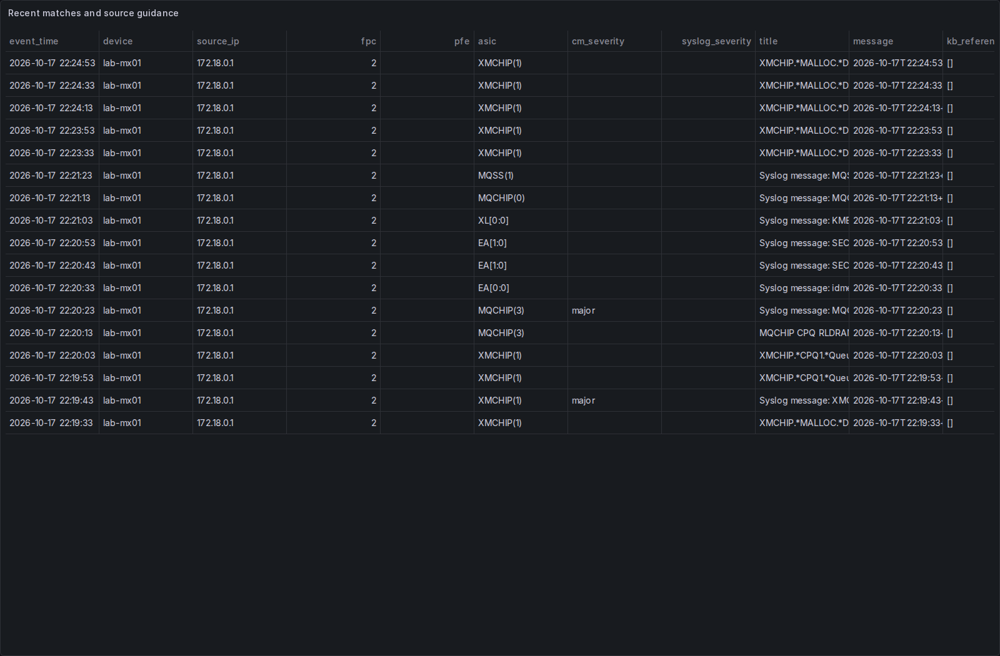
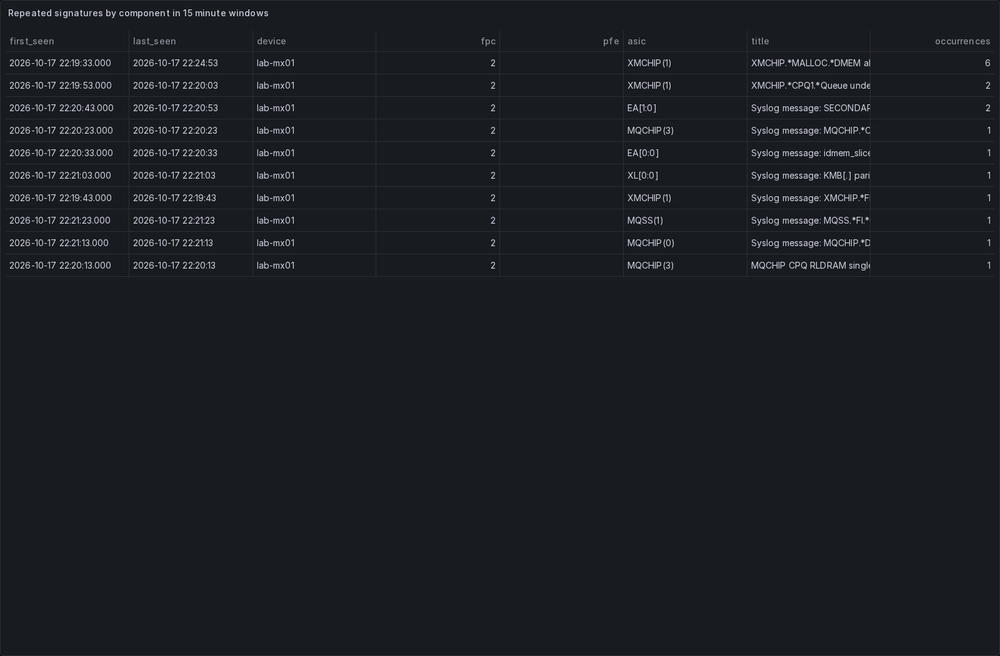
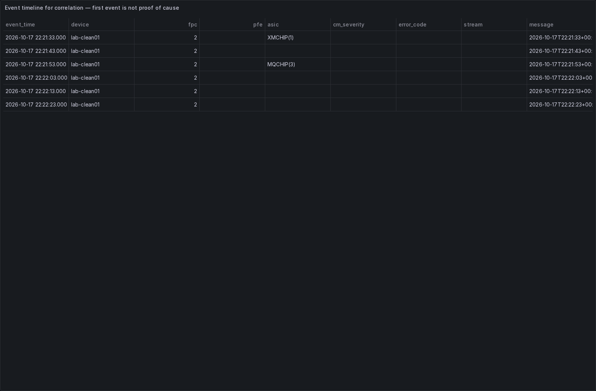

# Grafana demonstration

These are actual browser screenshots of Grafana running with JLS, PostgreSQL and Logstash in an isolated Docker Compose stack. All device names, log events and alarms are synthetic. No screenshots are mockups.

Captured: 2026-10-17T22:27:49.802304+00:00. [Workflow run](https://github.com/kbedford/JLS/actions/runs/39075015171). Source commit: `728cecd60afe1b3c2b3dbae8374eb4eebd3a610c`.

## Verified results

| Check | Observed |
| --- | ---: |
| Stored log events | 23 |
| Matched events / rule hits | 17 |
| Unmatched logs retained | 6 |
| Explicit major CM alarms | 2 |
| Active catalogue rules | 98 |
| Grafana datasource query errors | 0 |

The 18 base cases contain 12 matching errors and 6 negative cases. Five additional DMEM parity occurrences demonstrate repetition (six total DMEM occurrences). Two dummy messages explicitly carry `severity: major`; severity is not inferred from the matched rule. Repetition groups use fixed 15-minute windows and can split across a boundary. Overview summary counters are global; device selection filters the detailed tables.

## Overview

Matched faults, CM alarm counts and recent matching messages.

## Matched errors

Real Junos-style dummy messages matched against the bundled catalogue. Additional guidance, KB/PR references and raw message columns are available by horizontally scrolling the live table.

## Repeated errors

The occurrence view groups repeated fault signatures by device and component.

## Negative cases: retained without fault matches

The `lab-clean01` timeline contains six unmatched logs, including normal BGP/interface messages and an unknown diagnostic fault. No match means no catalogue pattern matched; it does not prove device health.

## Reproduce

Use **Actions → Grafana demo captures → Run workflow**. The workflow starts a fresh stack, sends the [dummy logs](dummy-junos.log) over TCP, verifies database counts, captures Chromium screenshots and commits only this demo folder. It also saves a downloadable artifact. The stack is removed afterwards.

For a local reproduction, create a separate checkout and empty Docker volumes, run `python3 tools/setup.py` and `docker compose up --build -d --wait`, install `playwright==1.56.0`, run `playwright install --with-deps chromium`, then `python tools/capture_grafana.py`. The script refuses a non-empty event table. Never run it on a production stack. Log timestamps are regenerated relative to capture time so dashboard time filters show the test data.

[Machine-readable evidence](results.json) · [Detailed matching tests](../DEMONSTRATION.md)
